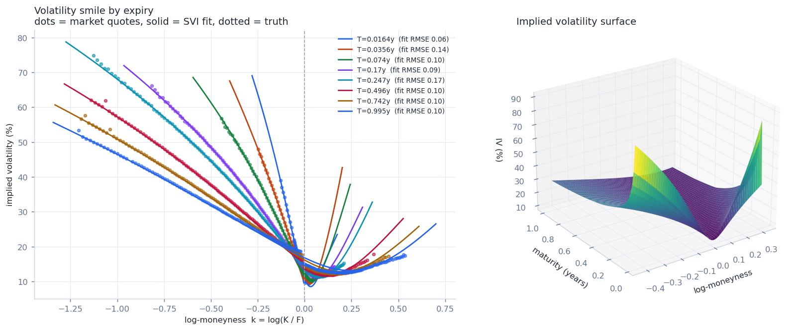
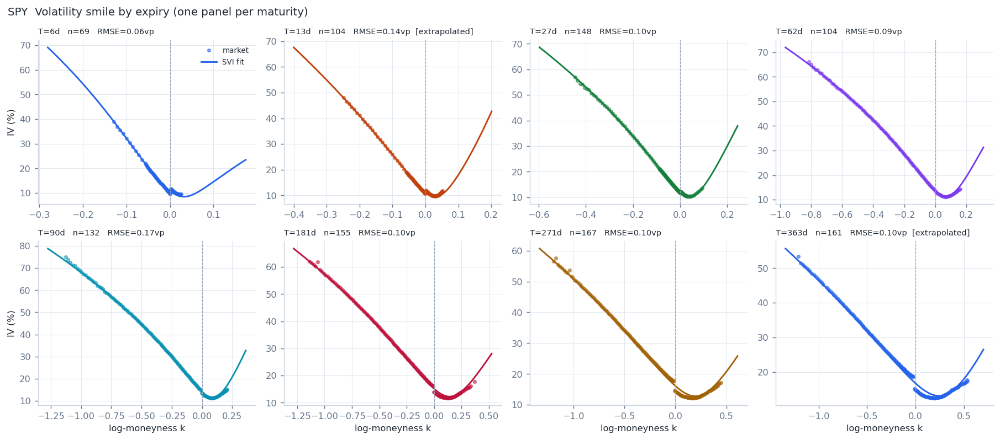
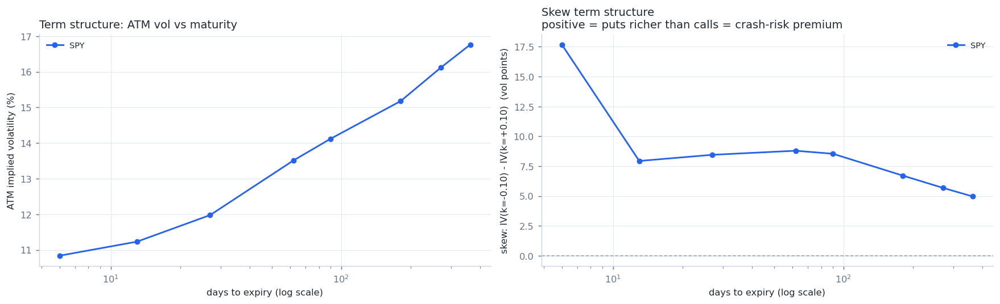
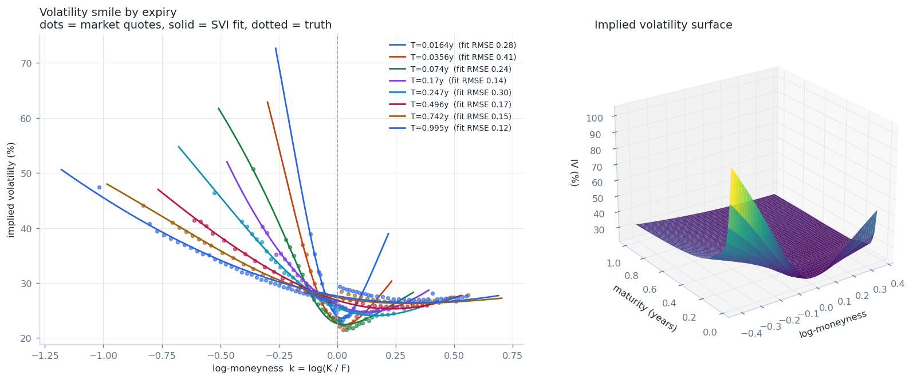
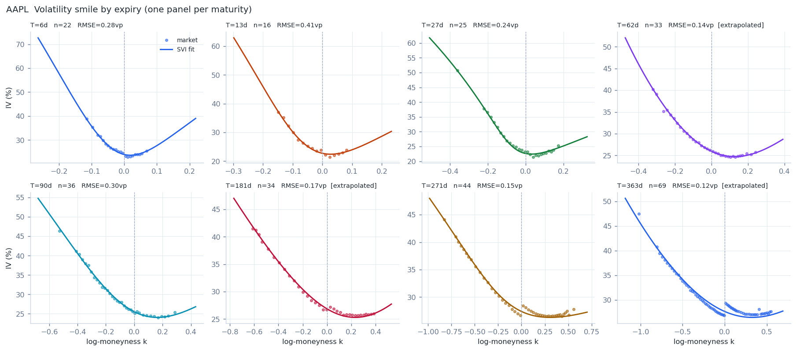
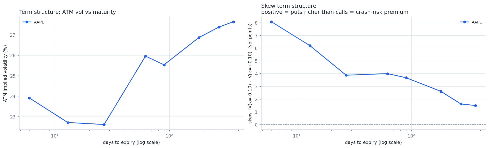
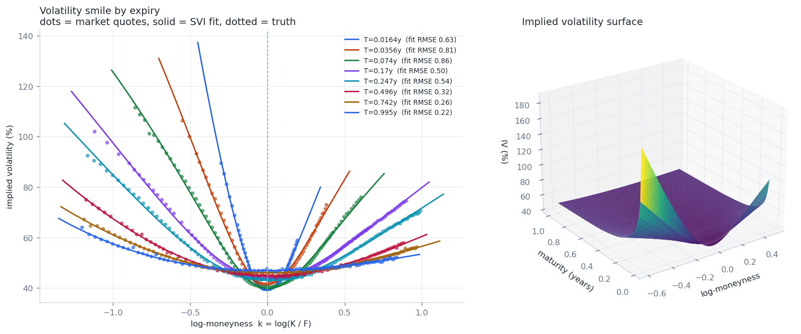
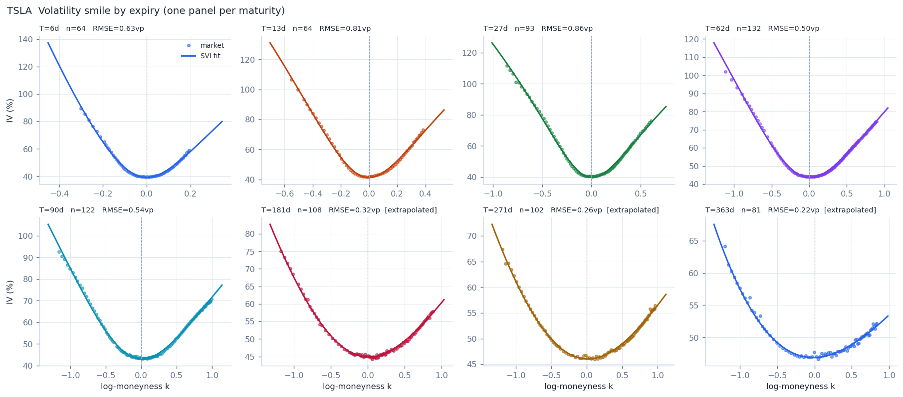
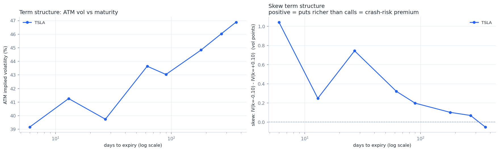
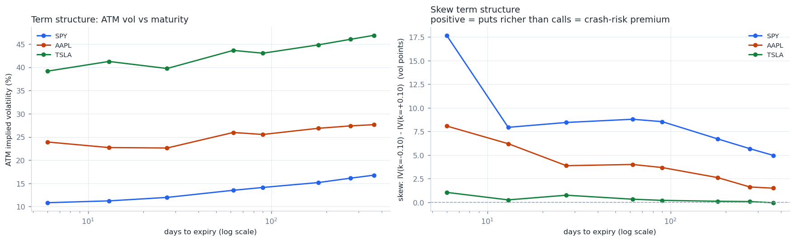

# Results: real-chain calibration and validation

Snapshot date **2026-09-19**. Three tickers: **SPY** (S&P 500 index ETF),
**AAPL** (large, stable single name), **TSLA** (high-volatility single name).
Chains pulled live from Yahoo Finance via `yfinance` and frozen to CSV
(`data/chains/`) so every number below is reproducible offline — see
`scripts/fetch_real_chains.py`. Full methodology and terms are explained from
first principles in `docs/CONCEPTS.md`; this document is the numbers.

---

## 1. Pricing and Greeks: how accurate is the pricer, really?

Produced by `scripts/00_validate_pricer.py` → `results/validation_report.json`.
Four checks, each an *independent* verification, not a repeat of the same
formula against itself (see that script's docstring for why each one counts
as independent):

| check | what it verifies | configurations | **max error** |
|---|---|---:|---:|
| Put-call parity | `C - P = S e^{-qT} - K e^{-rT}`, a model-free no-arbitrage identity | 8,640 | **5.68 × 10⁻¹⁴** (machine precision) |
| Greeks vs. finite difference | closed-form derivatives vs. numerically perturbing each input | 72 | **1.66 × 10⁻⁶** relative (gamma, the worst of the five) |
| Implied-vol round trip | price a known σ, invert, recover σ | 197 | **8.22 × 10⁻¹⁵** absolute vol error, 0 failed inversions, 7.18 mean Newton iterations |
| Independent integration cross-check | closed form vs. `scipy.integrate.quad` over the risk-neutral lognormal density (no `d1`/`d2`/`N()` — a genuinely different code path) | 432 | **5.15 × 10⁻⁴** absolute, **2.62 × 10⁻⁴** relative (this is `quad`'s own numerical-integration error, not a pricer defect) |

Full per-Greek breakdown:

| Greek | max relative error vs. finite difference |
|---|---:|
| delta | 1.29 × 10⁻⁶ |
| gamma | 1.66 × 10⁻⁶ |
| vega | 6.89 × 10⁻⁷ |
| theta | 1.18 × 10⁻⁷ |
| rho | 2.31 × 10⁻⁹ |

**Reading these numbers**: parity and the IV round-trip land at machine
precision (~10⁻¹⁴–10⁻¹⁵) because both are, in the end, checking that floating
point arithmetic was done correctly on an exact formula — there is no
approximation in the loop for either. The Greeks and the integration
cross-check are the two checks that *could* have exposed a real conceptual
bug (a wrong derivative, a wrong risk-neutral density) rather than an
arithmetic one, and both land at noise-floor-of-the-method size (a few parts
per million for the Greeks, a few basis points for `quad`'s own quadrature
error). Total runtime: 37.9s for all four checks combined.

---

## 2. Per-ticker SVI calibration

Common pipeline for all three: `load_cached_chain` → `implied_forward_rate`
(put-call parity, **r fixed at 4.2%**, forward/dividend-yield `q` extracted
per expiry — see §4 for why r is fixed rather than also extracted) →
`clean_chain` → `build_surface` (SVI per expiry, vega-weighted, robust
second pass). Eight expiries per ticker, spread ~1 week to ~1 year
(`scripts/fetch_real_chains.py`'s `TARGET_DAYS`), not the nearest eight
listed — see §4 for why that distinction mattered.

### SPY

Spot 761.69. 2,621 raw quotes → **1,126 kept (43.0%)** after cleaning.
Fit runtime: **69.05s** for 8 expiries (8.6s/expiry). 100% of implied-vol
inversions converged.

| T (days) | n | dropped | ATM vol | skew¹ | fit RMSE (vol pts) | butterfly | reliable² |
|---:|---:|---:|---:|---:|---:|---|---|
| 6 | 69 | 4 | 10.84% | +17.69 | 0.063 | OK | yes |
| 13 | 104 | 6 | 11.23% | +7.94 | 0.137 | OK | **no** |
| 27 | 148 | 3 | 11.98% | +8.45 | 0.099 | VIOLATION | yes |
| 62 | 104 | 9 | 13.51% | +8.79 | 0.092 | VIOLATION | yes |
| 90 | 132 | 9 | 14.12% | +8.54 | 0.172 | OK | yes |
| 181 | 155 | 6 | 15.18% | +6.71 | 0.103 | VIOLATION | yes |
| 271 | 167 | 13 | 16.12% | +5.67 | 0.097 | OK | yes |
| 363 | 161 | 36 | 16.76% | +4.97 | 0.099 | OK | **no** |

Calendar arbitrage: **VIOLATION**, worst total-variance decrease
-5.72 × 10⁻³, checked over k ∈ [-0.43, +0.32] (see §4). Forward extraction:
q converges from -8.8% (6d) to +0.53% (363d) as maturity grows — see §4 for
why the short end is not economically meaningful.

### AAPL

Spot 336.13. 1,079 raw quotes → **286 kept (26.5%)** — the thinnest chain of
the three; AAPL's per-expiry strike ladder is simply less dense than SPY's.
Fit runtime: **125.15s** for 8 expiries (15.6s/expiry — the slowest per-slice
fit, likely because fewer points per expiry gives the SVI optimizer's grid
search less signal to converge quickly on). 100% IV convergence.

| T (days) | n | dropped | ATM vol | skew¹ | fit RMSE (vol pts) | butterfly | reliable² |
|---:|---:|---:|---:|---:|---:|---|---|
| 6 | 22 | 0 | 23.91% | +8.08 | 0.281 | VIOLATION | yes |
| 13 | 16 | 0 | 22.71% | +6.20 | 0.411 | VIOLATION | yes |
| 27 | 25 | 2 | 22.61% | +3.87 | 0.242 | OK | yes |
| 62 | 33 | 1 | 25.96% | +4.00 | 0.143 | OK | **no** |
| 90 | 36 | 0 | 25.53% | +3.67 | 0.304 | OK | yes |
| 181 | 34 | 0 | 26.86% | +2.61 | 0.170 | OK | **no** |
| 271 | 44 | 2 | 27.38% | +1.61 | 0.148 | OK | yes |
| 363 | 69 | 2 | 27.64% | +1.49 | 0.121 | OK | **no** |

Calendar arbitrage: **VIOLATION**, worst total-variance decrease
-9.64 × 10⁻⁴ (an order of magnitude smaller than SPY's), checked over
k ∈ [-0.41, +0.37]. Forward extraction: q settles near +0.1–0.6% at the
longer maturities, broadly consistent with AAPL's small trailing dividend
yield.

### TSLA

Spot 364.27. 1,832 raw quotes → **774 kept (42.2%)**. Fit runtime:
**65.35s** for 8 expiries (8.2s/expiry). 100% IV convergence.

| T (days) | n | dropped | ATM vol | skew¹ | fit RMSE (vol pts) | butterfly | reliable² |
|---:|---:|---:|---:|---:|---:|---|---|
| 6 | 64 | 0 | 39.16% | +1.04 | 0.626 | OK | yes |
| 13 | 64 | 0 | 41.25% | +0.25 | 0.805 | OK | yes |
| 27 | 93 | 0 | 39.73% | +0.74 | 0.862 | OK | yes |
| 62 | 132 | 1 | 43.63% | +0.32 | 0.499 | OK | yes |
| 90 | 122 | 1 | 43.02% | +0.20 | 0.538 | OK | yes |
| 181 | 108 | 0 | 44.82% | +0.10 | 0.321 | OK | **no** |
| 271 | 102 | 1 | 46.02% | +0.07 | 0.255 | OK | **no** |
| 363 | 81 | 5 | 46.88% | -0.05 | 0.221 | OK | **no** |

Calendar arbitrage: **VIOLATION**, worst total-variance decrease
-1.12 × 10⁻², the largest of the three in absolute terms (though on a much
higher base level of variance — TSLA's ATM vol is 2.5–4× SPY's), checked
over k ∈ [-0.60, +0.49] — TSLA's chain covers the widest moneyness range,
which is why its checked k-range is also the widest. Forward extraction: q
stays small and negative throughout (-1.4% to -0.1%), consistent with a
non-dividend-paying stock whose only carry cost is a small stock-borrow
premium.

¹ *skew* = IV(k=-0.10) − IV(k=+0.10), in vol points, at that expiry's SVI
fit — a fixed-moneyness metric, not SVI's raw `rho` parameter. See §4 for
why.
² *reliable* = the fitted SVI vertex falls within the strikes actually
observed for that expiry (`SVIParams.reliable()`); "no" flags a slice whose
curve shape away from the observed data is extrapolation, not measurement.

---

## 3. Cross-ticker comparison and what the skew means economically

| | SPY (index) | AAPL (large, stable) | TSLA (high-vol) |
|---|---:|---:|---:|
| ATM vol, 1 week | 10.8% | 23.9% | 39.2% |
| ATM vol, 1 year | 16.8% | 27.6% | 46.9% |
| skew, 1 week | +17.7 vp | +8.1 vp | +1.0 vp |
| skew, 1 year | +5.0 vp | +1.5 vp | -0.1 vp |

Two separate things are happening here, and conflating them is the most
common mistake in reading a vol surface:

**Overall level** (ATM vol) increases from SPY → AAPL → TSLA — exactly what
you'd expect: an index is a diversified basket, so idiosyncratic risk
*cancels* across its 500 constituents and only systematic risk survives,
leaving the lowest level; TSLA is one stock with no diversification and
substantial company-specific catalyst risk (deliveries, autonomy
announcements, a founder with an unusually large influence on the share
price), leaving the highest.

**Skew** (put-call asymmetry) runs in the *opposite* order: steepest for
SPY, close to flat for TSLA. This is the more interesting result, because it
is not simply "more uncertainty = more skew" — TSLA has by far the most
uncertainty and by far the *least* skew. The reason is what kind of
uncertainty each one prices:

- SPY's skew is compensation for **systematic crash risk and the leverage
  effect** (`docs/CONCEPTS.md` §9, §19): when the market falls, leverage and
  volatility rise together, and a falling index drags nearly every
  portfolio down with it, so insurance against that specific, correlated
  event commands a persistent premium. This is a structural feature of
  *index* options, documented since October 1987, and it shows up here at
  +17.7 vol points on the shortest SPY expiry.
- TSLA's uncertainty is dominated by **idiosyncratic, two-sided catalyst
  risk** — a single earnings print, delivery number, or announcement can
  move the stock sharply in *either* direction. The market has no
  particular reason to price crash protection richer than melt-up
  protection when the realistic tail events are two-sided, so the smile
  comes out close to symmetric even though it is, in absolute terms, far
  wider than SPY's.
- AAPL sits between the two, as its size and profile would suggest: too
  large and diversified-by-product-line to move purely on one binary
  catalyst the way TSLA can, but still a single name without an index's
  diversification, so its skew (+8.1 vp short-dated) is real but roughly
  half of SPY's.

**A caveat this project is honest about**: SPY and TSLA are both flagged
with real (small) calendar-arbitrage violations (§1's `VIOLATION`
verdicts above), and several slices per ticker are flagged `reliable=no`.
None of this changes the qualitative comparison — the skew ordering
(SPY > AAPL > TSLA) holds whether or not the flagged slices are included,
because it is visible directly in the raw market quotes before any SVI
fitting happens at all (see `docs/CONCEPTS.md` §12b) — but it does mean the
*precise* vol-point numbers above should be read as "here is the fit's best
estimate, with its own honestly-reported error bars," not as
exact market truth.

---

## 4. Design choices worth defending

**Why r is assumed and q is extracted, not the other way round.** An early
version of this pipeline tried to extract *both* the discount rate `r` and
the forward `F` from put-call parity simultaneously, per expiry. On SPY's
weekly expiries this produced `r` estimates swinging from -23% to +21%
between adjacent expiries — nonsense — while the forward `F` it also
produced stayed stable throughout. The reason: at short T, the discount
factor `e^{-rT}` is so close to 1 that the interest-rate signal in the data
is smaller than ordinary bid-ask noise, so `r` is not statistically
identifiable from short-dated quotes, while `F` (pinned by where the
call-minus-put line crosses zero) remains well identified regardless. The
fix — used throughout this report — fixes `r` at a known external rate
(4.2%) and solves only for the forward, which is the one quantity a short-
dated chain can actually reveal. Full derivation in `docs/CONCEPTS.md` §12b.

**Why the calendar-arbitrage check uses a data-driven k-range, not a fixed
one.** The first pass at calibrating SPY produced a calendar-arbitrage
violation of magnitude 10.5 — enormous, an order of magnitude larger than
anything a real market would show. The cause: one short-dated slice's
observed strikes covered only a narrow window (`k` from -0.25 to +0.05),
so its fitted SVI curve, while accurate *within* that window (RMSE 0.15 vol
points), was essentially unconstrained outside it — and the calendar check
was comparing it against a neighbouring slice at `k` values neither slice
had ever seen a quote for. `build_surface` now checks calendar consistency
only over the *intersection* of what every slice actually observed, which
shrank the same violation to -5.7 × 10⁻³ — real, but two orders of
magnitude smaller, and now attributable to a specific, correctly-flagged
slice rather than to an artifact of the check's own range.

**Why skew is measured as IV(k=-0.10) − IV(k=+0.10), not SVI's `rho`.** The
same narrow-strike-window problem above also degrades `rho`'s
interpretability: `rho`'s textbook reading is "the sign of the skew," but
that reading only holds when the fitted vertex (`m`) sits inside the
observed strikes. Several slices in this report (flagged `reliable=no`
above) fit a vertex *outside* their own data, at which point `rho`'s value
is whatever the optimizer needed to reproduce the visible smile shape from
an extrapolated vertex — it can even come out positive on a chain that is
visibly, unambiguously put-skewed by eye. The fixed-moneyness metric used
throughout this report reads the curve at two points that are always well
inside the fitted range, so it stays economically meaningful even on a
slice whose `rho` should not be trusted.

**American exercise.** All three tickers here are American-style equity
options; every price and implied vol in this pipeline uses the European
Black-Scholes formula. The OTM-only cleaning convention keeps the
early-exercise premium small (it is concentrated in in-the-money puts,
which this pipeline never uses), but it is not exactly zero, and this is
more relevant for TSLA (no dividend, but real borrow cost) and AAPL (a real
dividend, which drives early exercise of ITM calls just before an ex-div
date) than for SPY, where the OTM convention is closest to exact.

---

## 5. Summary table

| | SPY | AAPL | TSLA |
|---|---:|---:|---:|
| Snapshot | 2026-09-19 | 2026-09-19 | 2026-09-19 |
| Spot | 761.69 | 336.13 | 364.27 |
| Raw quotes | 2,621 | 1,079 | 1,832 |
| Kept after cleaning | 1,126 (43.0%) | 286 (26.5%) | 774 (42.2%) |
| Expiries fit | 8 | 8 | 8 |
| Fit runtime | 69.1s (8.6s/expiry) | 125.2s (15.6s/expiry) | 65.4s (8.2s/expiry) |
| IV inversion convergence | 100% | 100% | 100% |
| Fit RMSE, best expiry | 0.063 vp | 0.121 vp | 0.221 vp |
| Fit RMSE, worst expiry | 0.172 vp | 0.411 vp | 0.862 vp |
| Butterfly-free expiries | 5 / 8 | 6 / 8 | 8 / 8 |
| Calendar arbitrage | violation (-5.7e-3) | violation (-9.6e-4) | violation (-1.1e-2) |
| Skew, 1 week | +17.7 vp | +8.1 vp | +1.0 vp |
